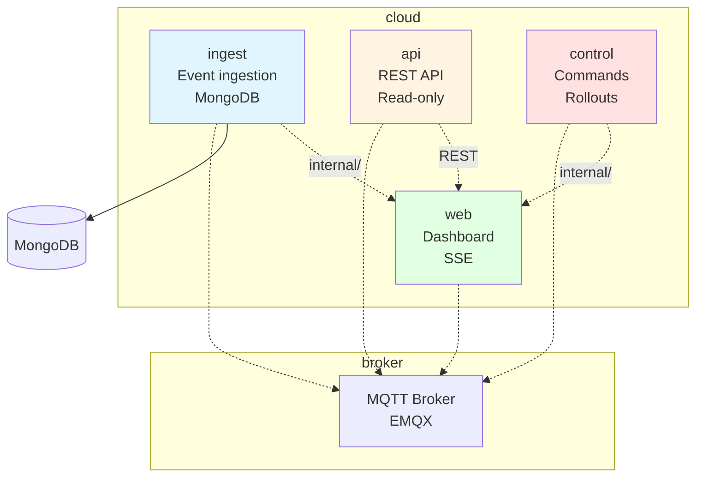

# Cloud Backend

Four Go services that handle event ingestion, REST API, device commands, and the web dashboard.

## Architecture



## Services

### ingest
Event ingestion and database storage.

- **Subscribes**: `$share/ingest/fleet/+/+/up/#` and `fleet/+/+/status`
- **Writes**: MongoDB (events, clips, devices, errors)
- **Handles**: Out-of-order arrival, duplicate delivery
- **Stateless**: Horizontally scalable

### api
REST API for events and device state.

- **Endpoints**: Events, devices, errors, health
- **Auth**: Bearer token (OIDC JWT in production)
- **Read-only**: Server-side tenant filtering
- **History**: Cursor-based pagination, no offset

### control
Commands, configuration, and firmware rollouts.

- **Commands**: CaptureNow, RebootDevice
- **Config**: Desired state with versioning
- **Rollouts**: Staged deployment with automatic halt
- **Single writer**: Prevents config/firmware conflicts

### web
Dashboard with live updates.

- **Server**: Go templates, vanilla JavaScript
- **Live updates**: Server-Sent Events with resume
- **History**: Calls `api` service
- **Clips**: Short-lived signed URLs

## Data Model

```
TENANT ||--o{ DEVICE : owns
DEVICE ||--o{ EVENT : raises
EVENT ||--o| CLIP : has
DEVICE ||--o{ DEVICE_ERROR : reports
FIRMWARE_RELEASE ||--o{ ROLLOUT : "deployed by"
ROLLOUT ||--o{ DEVICE : targets
```

### Access Patterns

| Query | Index |
|-------|-------|
| Events for a device, newest first | `{tenant_id, device_id, occurred_at: -1}` |
| Fleet-wide events by time | `{tenant_id, occurred_at: -1}` |
| Events by type | `{tenant_id, event_type, occurred_at: -1}` |
| SSE resume | `{tenant_id, received_at: 1, _id: 1}` |
| Retention | TTL index on `received_at` (90 days) |

## Messaging

### Ingest Topics

- `$share/ingest/fleet/+/+/up/#` - Upload events (shared subscription)
- `fleet/+/+/status` - Device status

### Internal Notifications

- `internal/stored/{tenant}` - After database commit
- `internal/dead-letter` - Invalid/undecodable messages

## Blob URLs

| Operation | URL Type | Lifetime |
|-----------|----------|----------|
| Clip upload | PUT pre-signed | Until expiry |
| Clip playback | GET pre-signed | 60 seconds |
| Firmware download | GET pre-signed | Until expiry |

Clips use object keys derived from IDs: `clips/{tenant}/{device}/{yyyy}/{mm}/{dd}/{clip_id}.mp4`

## Observability

- **Metrics**: Prometheus `/metrics` on every service
- **Health**: `/healthz` (liveness), `/readyz` (readiness)
- **Tracing**: OpenTelemetry, event ID as correlation key
- **Alerts**: Consumer lag, dead letters, upload failures, offline clusters

## Key Design Decisions

- **MongoDB** - Flexible attributes, simple indexes, TTL retention
- **SSE with resume** - Simple, one-directional, proxy-friendly
- **Idempotent upserts** - Safe under at-least-once delivery
- **Single writer (control)** - Prevents config/firmware conflicts

See [ARCHITECTURE.md](../docs/ARCHITECTURE.md#6-cloud-architecture) for complete service details.
