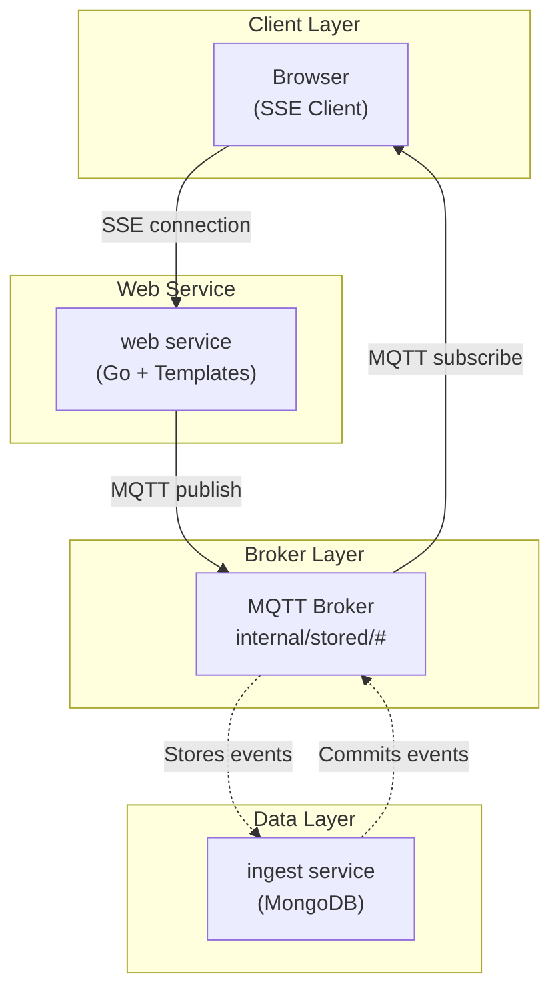
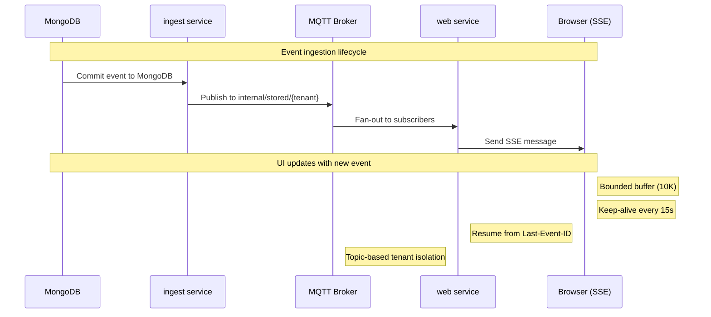
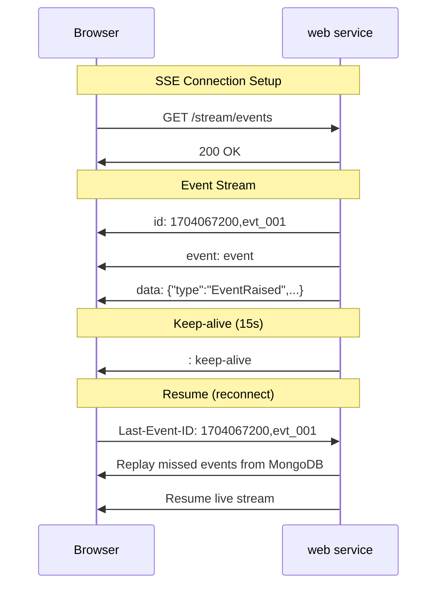
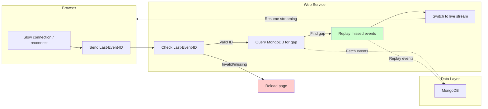
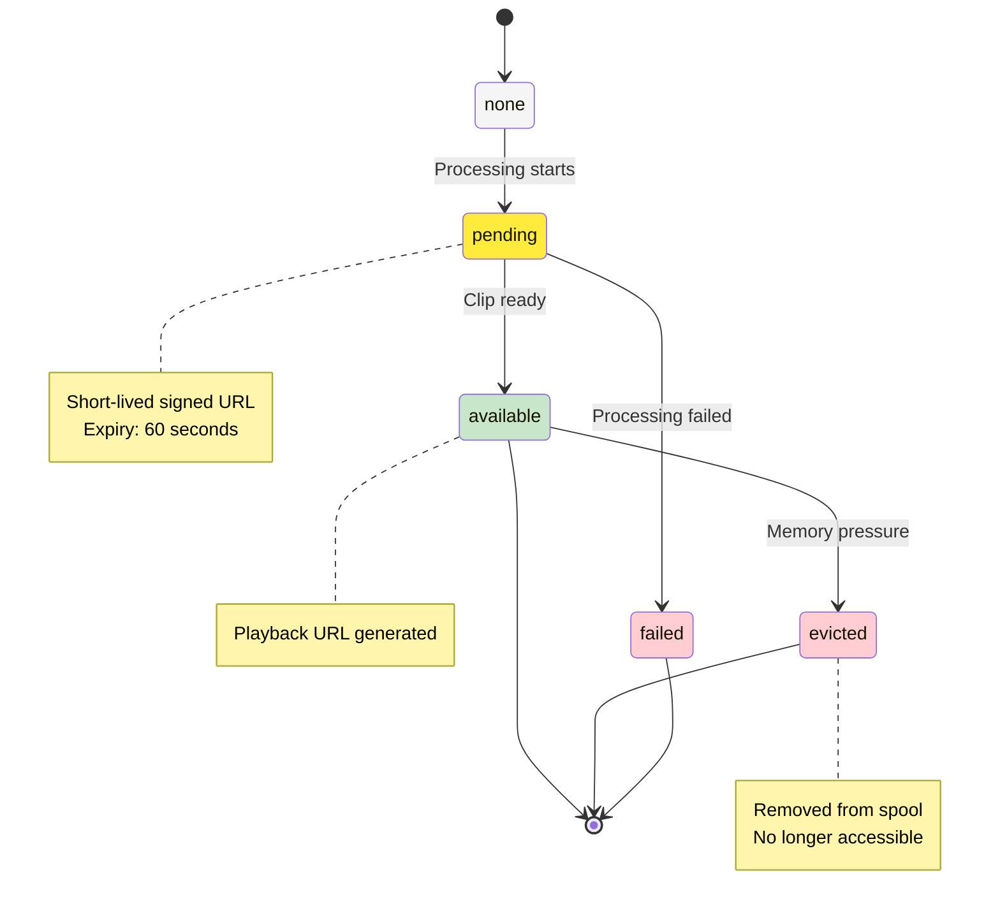

# Web Service

Dashboard with live updates using Server-Sent Events.

## Architecture



### Component Responsibilities

- **Browser**: SSE client with bounded buffer, resume support, keep-alive handling
- **Web Service**: SSE handler, event streaming, history replay, signed URL generation
- **MQTT Broker**: Message distribution, tenant isolation via topic partitioning
- **ingest**: Event storage, MongoDB operations, durability guarantees

## Endpoints

### Live Stream

```
GET /stream/events
```

Query parameters:

- `tenant_id` - Required (from session)
- `device_id` - Optional filter
- `type` - Optional filter

### History

```
GET /events
```

Calls the `api` service for history search.

## Server-Sent Events

### Subscription

Browser subscribes to `internal/stored/{tenant}` on the broker.

**Important**: This is a normal (non-shared) subscription, so every replica sees every notification.

### Notification Flow



### SSE Messages



### Resume Flow



### Slow Client Handling

- Bounded buffer per client
- Slow client disconnected
- Resume from cursor on reconnect

## Dashboard

### Features

- Live event stream
- Clip playback (short-lived signed URLs)
- Device status
- Fleet overview
- Error reports

### Clip Status



| Status | Display |
|--------|--------|
| `none` | No clip |
| `pending` | "Clip processing" |
| `available` | Playable |
| `failed` | Failure state |
| `evicted` | Evicted from spool |

### History Pages

Call the `api` service for:

- Event search
- Device state
- Error reports

## Templates

Go templates with vanilla JavaScript:

- `dashboard.html` - Main dashboard
- `event.html` - Event detail
- `device.html` - Device detail
- `errors.html` - Error reports

## Observability

| Metric | Description |
|--------|-------------|
| `web_connections_total` | Active SSE connections (gauge) |
| `web_sse_messages_total` | SSE messages sent (counter) |
| `web_resume_requests_total` | Resume requests (counter) |
| `web_error_total` | Server errors (counter) |

## Health

- `/health` - Liveness probe
- `/ready` - Readiness probe
- `/metrics` - Prometheus metrics

## Security

- Tenant filtering on server
- Signed URLs for clip access (60s expiry)
- Session-based authentication

## Performance

| Metric | Target |
|--------|--------|
| Event-to-visible latency | < 5 seconds (p95) |
| SSE message latency | < 100ms |
| Buffer size | 10,000 messages |
| Keep-alive interval | 15 seconds |
