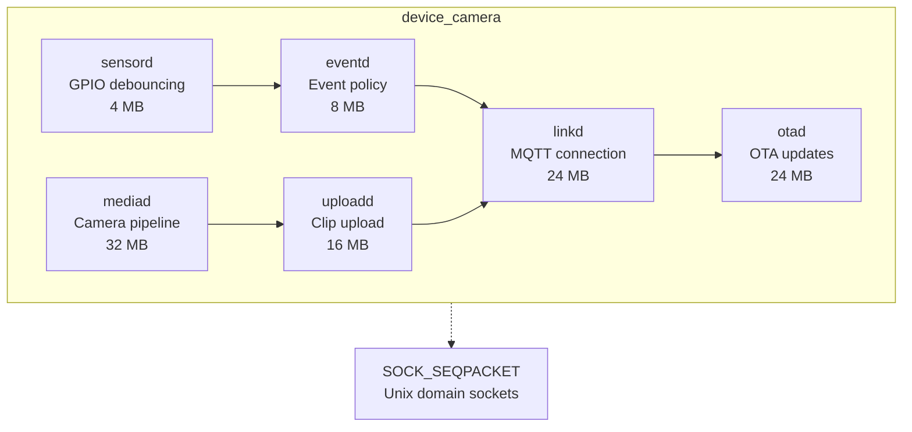

# Device Services

Six independent C++20 services that run on each camera device, communicating via Unix domain `SOCK_SEQPACKET` sockets.

## Architecture



## Services

### sensord (4 MB)
Hardware GPIO debouncing and initial event generation.

- **Role**: Debounce GPIO edges, generate raw events
- **Inputs**: GPIO file descriptors
- **Outputs**: Raw events to `eventd`
- **Memory limit**: 4 MB
- **Reboot time**: < 1 second

### eventd (8 MB)
Event policy, ID minting, and soft-state management.

- **Role**: Apply event policies, mint event IDs, manage cooldowns
- **Inputs**: Raw events from `sensord`
- **Outputs**: Filtered events to `linkd`
- **Memory limit**: 8 MB
- **Soft state**: Cooldown timers, debounce counters

### mediad (32 MB)
Camera pipeline and clip assembly.

- **Role**: Capture video frames, assemble clips
- **Inputs**: Camera device file descriptors
- **Outputs**: Clip files to `spool/`
- **Memory limit**: 32 MB
- **Resources**: Camera device, encoder

### uploadd (16 MB)
Clip upload with retry and backoff.

- **Role**: Upload clips to object storage
- **Inputs**: Clip files from `spool/`
- **Outputs**: Upload events to `linkd`
- **Memory limit**: 16 MB
- **Retry**: Exponential backoff with jitter

### linkd (24 MB)
Cloud MQTT connection and device identity.

- **Role**: Establish MQTT connection, hold TLS credentials
- **Inputs**: Events from `eventd`
- **Outputs**: Events to cloud broker
- **Memory limit**: 24 MB
- **Security**: Holds TLS certificate and private key

### otad (24 MB)
Over-the-air update orchestration.

- **Role**: Download, verify, and apply firmware updates
- **Inputs**: Update manifests from `control`
- **Outputs**: Update status to `linkd`
- **Memory limit**: 24 MB
- **Privileged**: Runs with elevated privileges during update

## Memory Budget

| Service | Memory Limit | Description |
|---------|--------------|-------------|
| sensord | 4 MB | GPIO debouncing |
| eventd | 8 MB | Event policy and state |
| mediad | 32 MB | Camera pipeline |
| uploadd | 16 MB | Upload state and retry |
| linkd | 24 MB | MQTT connection |
| otad | 24 MB | Update orchestration |
| **Total** | **128 MB** | Per-device budget |

## Supervision

Each service runs under systemd with:

- Socket activation (no steady-state memory cost)
- Watchdog monitoring (restart on failure)
- Cgroup memory limits
- File descriptor inheritance (hardware fds survive restarts)

## Communication

Services communicate via Unix domain `SOCK_SEQPACKET` sockets:

- Message boundaries (no framing needed)
- Peer credentials (service identity)
- Reliable delivery (acknowledged)
- Socket activation (lazy initialization)

## Message Classes

| Class | Purpose | Example |
|-------|---------|---------|
| Reliable (acknowledged) | Critical state changes | EventRaised, ConfigApplied |
| Notify | Fan-out, best effort | DeviceHeartbeat, HealthReport |

## Crash Recovery

- **sensord crash**: Restarted within seconds; GPIO fds survive via systemd fd store
- **mediad crash**: Event still reported; clip reported failed
- **uploadd crash**: Spool and retry state durable; uploads resume
- **linkd crash**: Outbox durable; peers retry until it returns
- **eventd crash**: Restarts and rebuilds soft state; window between trigger and ack is milliseconds
- **otad crash**: Active slot untouched; download resumes

## Build

```bash
cd device/camera
cmake --preset=host-debug
cmake --build --preset=host-debug
```mermaid
graph TD
    subgraph device_camera
        sensord["sensord<br/>GPIO debouncing<br/>4 MB"]
        eventd["eventd<br/>Event policy<br/>8 MB"]
        mediad["mediad<br/>Camera pipeline<br/>32 MB"]
        uploadd["uploadd<br/>Clip upload<br/>16 MB"]
        linkd["linkd<br/>MQTT connection<br/>24 MB"]
        otad["otad<br/>OTA updates<br/>24 MB"]
        
        sensord --> eventd
        eventd --> linkd
        mediad --> uploadd
        uploadd --> linkd
        linkd --> otad
    end
    
    device_camera -.-> SOCK["SOCK_SEQPACKET<br/>Unix domain sockets"]
