# Camera Fleet Platform: Architecture

## Contents

1. [Purpose and scope](#1-purpose-and-scope)
2. [Goals, constraints and assumptions](#2-goals-constraints-and-assumptions)
3. [System overview](#3-system-overview)
4. [Device architecture](#4-device-architecture)
5. [Messaging contracts](#5-messaging-contracts)
6. [Cloud architecture](#6-cloud-architecture)
7. [Simulation](#7-simulation)
8. [Observability](#8-observability)
9. [Failure modes](#9-failure-modes)
10. [Testing strategy](#10-testing-strategy)
11. [Repository, build and delivery](#11-repository-build-and-delivery)
12. [Delivery scope and non-goals](#12-delivery-scope-and-non-goals)
13. [Decision log](#13-decision-log)

---

## 1. Purpose and scope

A fleet of camera devices in the field captures short video clips and raises events (motion detected, doorbell pressed). Each device uploads its events and clips to a cloud backend. A web dashboard shows events and clips as they arrive and lets operators browse history. Operators can also push commands and configuration to devices and roll out new firmware.

The platform is designed to ship to real devices. Devices are assumed to be unattended, resource constrained, and connected over unreliable links. Every design choice below follows from three rules:

1. **No event is silently lost.** Events are durable on the device until the cloud has acknowledged them.
2. **Everything is retryable and idempotent.** Delivery is at-least-once; duplicates are harmless.
3. **A device can always be recovered remotely.** Updates are atomic and roll back automatically.

For the exercise, devices are simulated: clips and events are generated rather than recorded. The simulated devices run the same service binaries as production, with only the hardware and media adapters replaced (see [Simulation](#7-simulation)).

## 2. Goals, constraints and assumptions

### Device target

| Item | Assumption |
|---|---|
| CPU | Single-core ARM Cortex-A class |
| RAM | 128 MB minimum, 256 MB nominal |
| Storage | 512 MB to 4 GB flash with a dedicated persistent data partition |
| OS | Yocto-built Linux, systemd, read-only A/B root filesystems |
| Connectivity | Intermittent Wi-Fi or cellular; NAT idle timeouts of about 60 s |
| Toolchain | clang or GCC with C++20 |

### Fleet scale used for sizing

| Metric | Value |
|---|---|
| Devices | 100,000 |
| Event rate | about 2 M per day, about 23 per second on average, 20x peaks |
| Clip size | 2 to 10 MB (5 MB typical) |
| Clip volume | > TB per day, which is why clips never travel through the message broker or the database |
| Heartbeat interval | 300 s, about 330 messages per second fleet-wide |

### Non-functional goals

| Goal | Target |
|---|---|
| Event-to-dashboard latency (device online) | p95 under 3 s |
| Event durability | Survives device reboot and power loss from the moment `linkd` acknowledges it |
| Device steady-state memory | Under about 50 MB across all services (enforced ceilings are higher; see 4.3) |
| Update safety | A failed update never leaves a device unreachable |
| Data isolation | Strict per-tenant separation in the API, topics and storage paths |

## 3. System overview

### 3.1 Component diagram

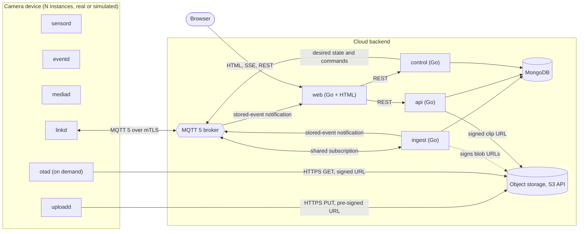

### 3.2 Components

| Component | Language | Responsibility |
|---|---|---|
| `sensord` | C++20 | Binds to hardware inputs, debounces, emits trigger messages |
| `eventd` | C++20 | Event policy (cooldowns, priorities), mints event and clip IDs, coordinates capture |
| `mediad` | C++20 | Camera pipeline, pre-roll buffer, clip assembly into the spool |
| `uploadd` | C++20 | Uploads clips to object storage with retry, backoff and error reporting |
| `linkd` | C++20 | The only cloud connection: identity, durable outbox, routing of downstream messages |
| `otad` | C++20 | Update orchestration: validation, download, install, health-checked commit, rollback |
| MQTT broker | EMQX | Device ingress, per-device authentication and ACLs, shared subscriptions |
| `ingest` | Go | Consumes device messages, writes event metadata, answers blob URL requests |
| `api` | Go | Read and search API for events, clips and devices |
| `control` | Go | Commands, configuration, firmware releases and rollouts; owner of desired state |
| `web` | Go + HTML | Dashboard with Server-Sent Events (SSE) for live data and the API for history |
| MongoDB | | Event metadata, devices, releases, rollouts |
| Object storage | MinIO / any S3 API | Clips and firmware images |

### 3.3 Technology stack

| Concern | Choice |
|---|---|
| Wire and IPC serialization | FlatBuffers, one schema set shared by C++ and Go |
| Device to cloud events and commands | MQTT 5 over TLS 1.3 with mutual authentication |
| Bulk transfer | HTTPS with pre-signed URLs |
| Local inter-process messaging | Unix domain `SOCK_SEQPACKET` sockets |
| Device supervision | systemd (socket activation, watchdog, cgroup limits, sandboxing) |
| Update framework (production) | RAUC with U-Boot A/B and boot counting |
| Device MQTT client | libmosquitto, driven by the service's own epoll reactor |
| Device HTTP client | libcurl multi interface, driven by the reactor |
| Device GPIO | libgpiod |

## 4. Device architecture

### 4.1 Process model

The device software is six cooperating processes. Each is an independent event-driven service with its own reactor, its own memory ceiling, its own Unix user and its own failure domain. They communicate only by message passing; there is no shared memory and no shared mutable state.

| Service | Owns | Why it is a separate process |
|---|---|---|
| `sensord` | Hardware input lines, debounce | Tiny and critical; must almost never crash |
| `eventd` | Event policy and identifiers | Pure coordination logic; trivially testable |
| `mediad` | Camera pipeline, pre-roll ring, clip files | Heaviest and most failure-prone; sacrificial under memory pressure |
| `uploadd` | Spool of ready clips, upload retry state | Slow and network-bound; must never block event handling |
| `linkd` | Cloud connection, device private key, durable outbox | Only network-facing process holding the identity key; smallest attack surface |
| `otad` | Update lifecycle, boot control, reboot privilege | Must work when other services are broken; only service allowed to touch the bootloader; socket-activated and idle most of the time |

### 4.2 Device message flow

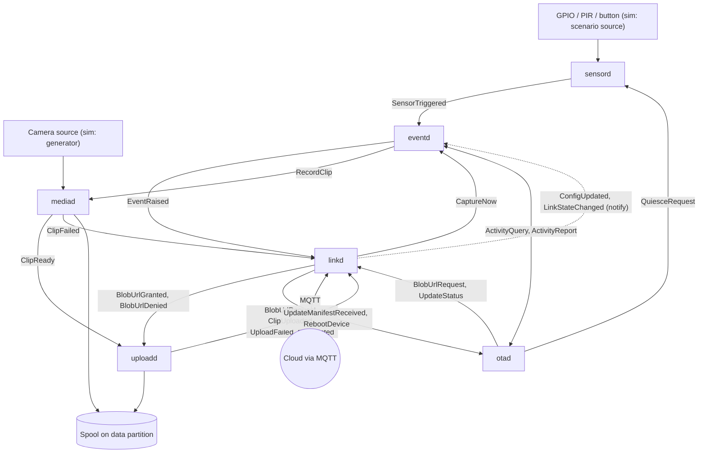

Solid arrows are acknowledged (reliable) sends. `HealthReport` flows from every service to `linkd` as a notification and is omitted from the diagram for clarity.

### 4.3 Supervision and resource limits

Every service is a systemd unit with `Restart=on-failure`, `WatchdogSec=30` (the reactor itself pings the watchdog every 10 s, so a hung loop is detected, not just a dead process), start-rate limiting against crash loops, and a socket unit so peers can connect before the service is up. The hardware watchdog is armed by systemd (`RuntimeWatchdogSec`).

| Service | Unix user | `MemoryMax` | Typical RSS target | `OOMScoreAdjust` | Notes |
|---|---|---|---|---|---|
| `sensord` | `camera-sensor` | 4 MB | 2 MB | -800 | Smallest and most protected; holds hardware fds in the systemd fd store across restarts |
| `eventd` | `camera-core` | 8 MB | 4 MB | -500 | |
| `mediad` | `camera-media` | 32 MB | 12 MB | +300 | Includes a pre-roll ring of at most 4 MB; first to be killed |
| `uploadd` | `camera-upload` | 16 MB | 6 MB | 0 | Streams clips from file; never holds a full clip in memory |
| `linkd` | `camera-link` | 24 MB | 8 MB | -400 | Sole holder of the device key |
| `otad` | `camera-update` | 24 MB | 12 MB | -200 | Socket-activated; exits when idle |

Hardening applied to all units: `NoNewPrivileges`, `ProtectSystem=strict`, `ProtectHome`, `PrivateTmp`, an empty capability bounding set (except where noted), `RestrictAddressFamilies` limited to what the service needs (`AF_UNIX` only for `sensord`, `eventd`, `mediad`), and explicit `ReadWritePaths`.

All services link libstdc++, libcurl and libmosquitto dynamically so library pages are shared between processes.

### 4.4 Code structure: reactor, bus and ports

Each service is a thin class on top of a shared reactor and bus library. All hardware, time and platform access goes through narrow interfaces (ports), with production and simulation adapters. Core logic depends only on ports.

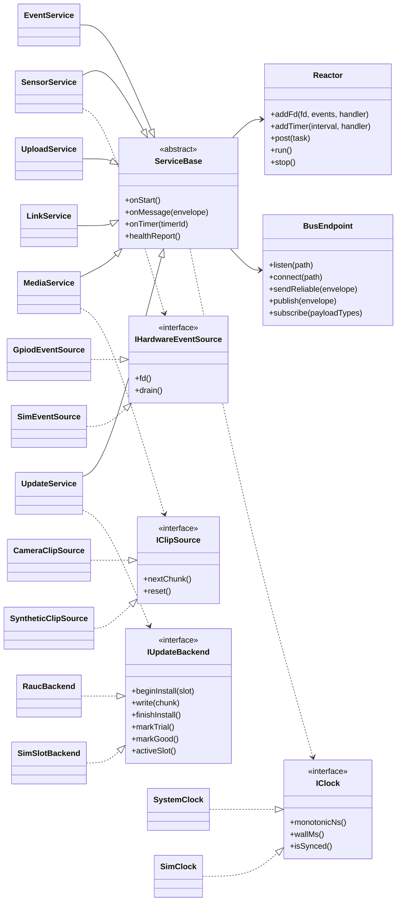

**Reactor rules (the distributed reactor pattern):**

- Each process runs a single-threaded epoll reactor. Everything is a file descriptor: hardware lines (`libgpiod` event fd), timers (`timerfd`), peer sockets, signals (`signalfd`), config changes (`inotify`), and library sockets (libmosquitto and libcurl expose their sockets to the reactor).
- Handlers never block. Work that would block (hashing, encoding) runs on a bounded worker thread that returns an immutable result message through an `eventfd`. `uploadd` and `linkd` use the async library interfaces and need no worker threads.
- Together the six reactors form a distributed reactor: events are demultiplexed at the source (`sensord`), then dispatched as messages to handlers that live in other processes.
- The simulated hardware source also exposes a file descriptor, so reactor code is identical for real and simulated hardware.
- State is owned by exactly one service. Other services hold only identifiers and copies of immutable messages.

### 4.5 Local messaging

**Transport.** Each service listens on `/run/camera/<service>.sock`, a `SOCK_SEQPACKET` Unix socket (reliable, ordered, message-boundary preserving, so no length framing is needed). Sockets are created by systemd socket units with group permissions, and each connection's peer credentials (`SO_PEERCRED`) are checked against the expected service user. Messages are FlatBuffers `Envelope` buffers of at most 64 KiB. Receive buffers come from an aligned pool so buffers can be read in place.

**Connection handshake.** A connecting peer sends `Hello` (its service identity and schema version). A subscriber then sends `Subscribe` listing the payload types it wants.

**Two delivery classes:**

| Class | Behaviour | Used for |
|---|---|---|
| **Reliable** | Point-to-point. The receiver handles or persists the message, then replies `Ack`. The sender retries with backoff (100 ms growing to 5 s, 30 s default deadline) until acknowledged, then reports itself `Degraded`. Receivers deduplicate by `message_id`. | Anything that must not be lost: triggers, events, clip hand-off, upload results, commands, update control |
| **Notify** | Fan-out to current subscribers, best effort. State-like types (`LinkStateChanged`, `ConfigUpdated`) are replayed to a new subscriber on `Subscribe`, so a restarted service always learns current state. | Health, link state, configuration |

**Control plane versus data plane.** Messages stay small. Clip bytes never pass through the bus. `mediad` writes a clip to `spool/tmp`, fsyncs, and renames it into `spool/ready`. The `ClipReady` message carries the path, size and checksum; receipt of that message **transfers ownership** of the file to `uploadd`, which later deletes it.

**Correlation.** Every message carries a `correlation_id`. For anything caused by an event, it is the event ID, so one event can be followed through every process and into the cloud from structured logs.

**Priorities.** P0 (doorbell and manual events, errors, update status), P1 (motion events, motion clips), P2 (telemetry). Under queue pressure P2 is dropped first and P0 is never dropped.

### 4.6 Event processing flow

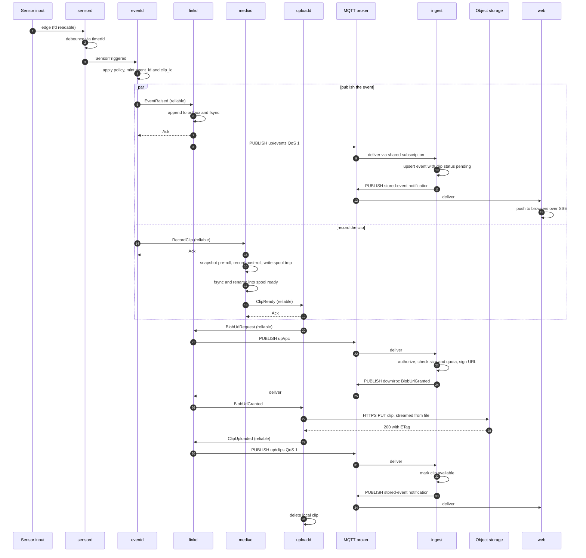

**Event policy in `eventd`:**

- Doorbell and manual events are never suppressed.
- Motion events have a cooldown (30 s by default, configurable). Triggers inside the cooldown are counted and reported as `suppressed_count` on the next motion event.
- Each event gets its own clip. The event is published immediately and the clip follows, so the dashboard shows the event within seconds with a "clip pending" status.
- Identifiers are UUIDv7-layout: a 48-bit millisecond field (wall time when synced, otherwise boot-relative) followed by random bits from `getrandom`. Uniqueness is guaranteed; ordering is never relied on for correctness.

**Clip content (simulation).** Clips are generated, not recorded. The default is a deterministic synthetic byte stream (a small header with device and clip IDs, seeded pseudo-random payload, checksum trailer) at a configurable size. A flag switches `mediad` to serve pre-generated test-pattern MP4 files so the dashboard can play them. Production clips are fragmented MP4.

### 4.7 Clip upload, backoff and error events

`uploadd` runs one state machine per clip and uploads one clip at a time by default.

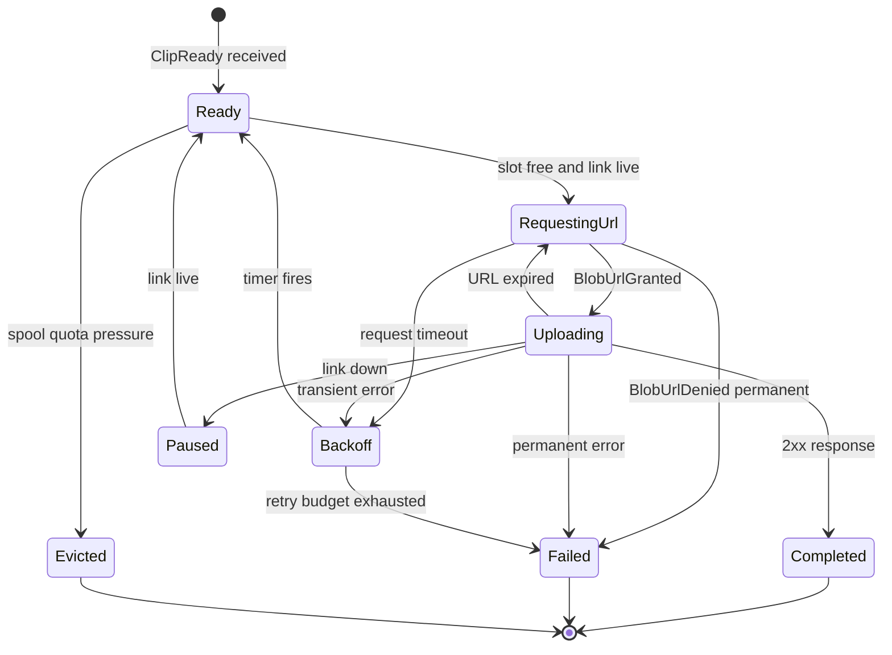

**Error classification**

| Class | Examples | Action |
|---|---|---|
| Transient | Timeout, DNS failure, TLS handshake failure, connection reset, 5xx, 429 (honour `Retry-After`) | Backoff and retry |
| Refreshable | 401/403 caused by an expired signature | Request a new URL (bounded number of refreshes) |
| Permanent | Other 4xx, size over `max_bytes`, checksum rejected, local file missing or corrupt | Fail immediately |

**Retry parameters**

| Operation | Strategy | Parameters |
|---|---|---|
| Clip upload | Exponential backoff with full jitter | Base 2 s, factor 2, cap 5 min. Budget: 24 h age or 20 attempts, counted only while the link is live |
| Blob URL request | RPC timeout, then backoff | 15 s timeout, base 2 s, cap 5 min |
| MQTT reconnect | Exponential backoff with full jitter | Base 1 s, factor 2, cap 120 s |
| Firmware download | Resumable (HTTP Range), exponential backoff | Base 5 s, cap 10 min, budget 72 h |
| Local reliable send | Exponential backoff | 100 ms to 5 s, 30 s deadline |

**Link awareness.** `uploadd` listens to `LinkStateChanged`. While the link is down it pauses instead of burning retries. This also prevents a fleet-wide thundering herd after a regional outage, because reconnects and retries are all jittered.

**Failure reporting.** When the budget is exhausted or a permanent error occurs, `uploadd` sends `UploadFailed` (reason code, attempts, last HTTP status, last error, retained flag) to `linkd` at P0. `linkd` publishes it to `up/errors`; if the broker is unreachable it waits in the durable outbox. The clip is retained in `spool/failed` for diagnostics for up to 24 h.

**Upload mechanics.** A single streamed `PUT` from file with a fixed small buffer. The signed URL binds the exact size and SHA-256 checksum header, so the object store rejects mismatched content. Clips are capped at 10 MB, so a retried single `PUT` is simpler and more robust than multipart (S3 multipart parts must be at least 5 MiB anyway). Bandwidth can be capped by configuration so uploads never starve events.

**Spool quota and eviction.** Default quota 256 MB. When full, the oldest P1 (motion) clips are evicted first, then the oldest P0 clips; a clip being uploaded is never evicted. Every eviction emits `ClipEvicted`.

### 4.8 Connectivity in `linkd`

`linkd` owns the single MQTT 5 session and carries both directions. It performs envelope-level validation only (schema verification, device targeting, expiry, replay protection); it contains no business logic. Its internals are split into an upstream module (outbox, publish) and a downstream module (subscribe, validate, route) within one process.

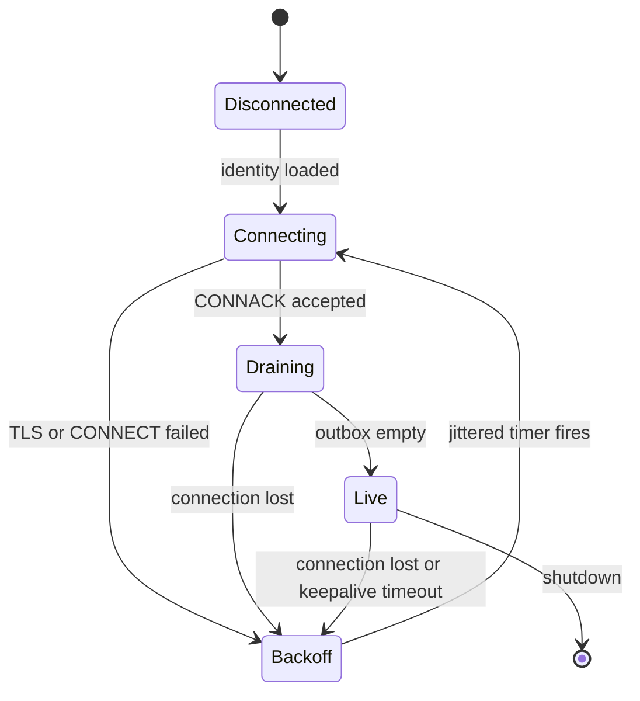

- **Session.** Client ID is the device UUID. A persistent session (7-day expiry) holds queued QoS 1 downstream commands across short disconnects, and keepalive is 60 s. A retained `DeviceStatus` is published on connect, and a last-will message sets it offline.
- **Durable outbox.** An append-only segmented journal on the data partition. Each record is a length, a CRC-32C and the `Envelope` bytes. P0 records are fsynced individually; P1 records are group-committed within 100 ms; P2 is buffered. Acknowledged records advance a cursor; fully acknowledged segments are deleted. The outbox quota is 16 MiB. When full, the oldest P2 is dropped first, then the oldest P1; P0 is never dropped (new P1 and P2 are rejected and the service reports `Degraded`).
- **Draining.** After a reconnect, the backlog is sent in priority order, then oldest first, with a rate limit. Fresh events are never delayed behind bulk telemetry.
- **Time.** Every message carries a monotonic and a wall timestamp, the boot ID, and a clock-synced flag (see [section 4.12](#412-time)).

### 4.9 Server-pushed messages

Downstream traffic takes two forms.

**Desired state (declarative).** The cloud publishes a retained `DesiredState` message per device containing the configuration version, the camera settings, and optionally a signed firmware manifest. A device that was offline converges as soon as it reconnects, and a device that reboots receives it again. The device reports applied state back through `DeviceHeartbeat` (firmware version, config version) and `UpdateStatus`.

**Commands (imperative).** Time-critical, one-shot actions: `CaptureNow` and `RebootDevice`. Commands are published at QoS 1 with a message-expiry interval so a stale command is discarded by the broker, carry a `command_id`, and are validated by `linkd`: addressed to this device, not expired (the device's own expiry check is used only when its clock is synced), and not a replay (a persisted window of recent command IDs). Each command produces a `CommandResult`.

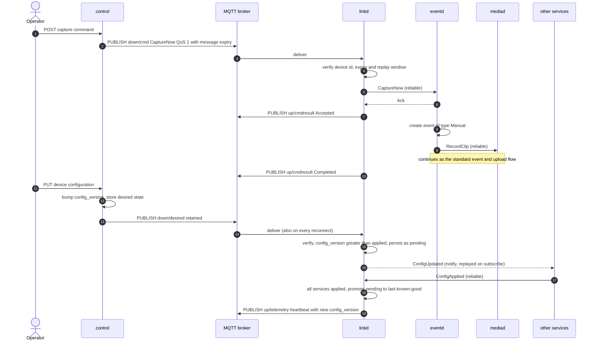

**Configuration safety.** Configuration is validated against bounds before it is applied. A new configuration stays `pending` until every service reports `ConfigApplied`; if any service fails or does not respond within 10 s, `linkd` reverts to the last-known-good configuration and reports the failure. Only a strictly greater `config_version` is applied.

### 4.10 Over-the-air updates

#### Design

- **Whole-image A/B updates.** The device has two read-only root filesystems (slot A and slot B), a bootloader (U-Boot) with a boot counter, and a persistent data partition. Updates are written to the inactive slot. The running system is never modified.
- **Update framework.** Production uses RAUC for slot handling and bootloader integration. `otad` is a thin orchestrator on top: it decides when and whether to update, drives the framework through the `IUpdateBackend` port, and reports progress through the bus. The simulator provides a `SimSlotBackend` implementing the same port.
- **Authenticity is end to end.** TLS authenticates the pipe only. Firmware manifests are signed by an offline release key and verified on the device against a keyring rooted in the secure-boot chain (two key IDs supported for rotation). The signature covers a canonical, separately serialized manifest body, so a compromised broker, CDN or control service cannot push firmware. The image itself carries a bundle signature checked by the update framework, and the manifest binds the image by SHA-256.
- **Anti-rollback.** The manifest carries a monotonic `anti_rollback_counter`; the device refuses lower values (and lower versions than the minimum permitted source version).
- **Staged rollouts** are controlled by the cloud (see [section 6.6](#66-control-service-and-rollouts)); the device only converges to its own desired state and reports results.
- **Privilege.** `otad` is the only service allowed to modify the bootloader environment, write the inactive slot, or reboot the device. Other services request a reboot by sending `RebootDevice` to `otad`.

#### Persistent layout

```
bootloader | rootfs A (ro, verity) | rootfs B (ro, verity) | data (rw)
                                                             /data/camera/
                                                               identity/  outbox/  spool/  state/  config/  update/
```

The outbox, spool, configuration and update state live on the data partition and survive an update and a rollback.

#### Update lifecycle

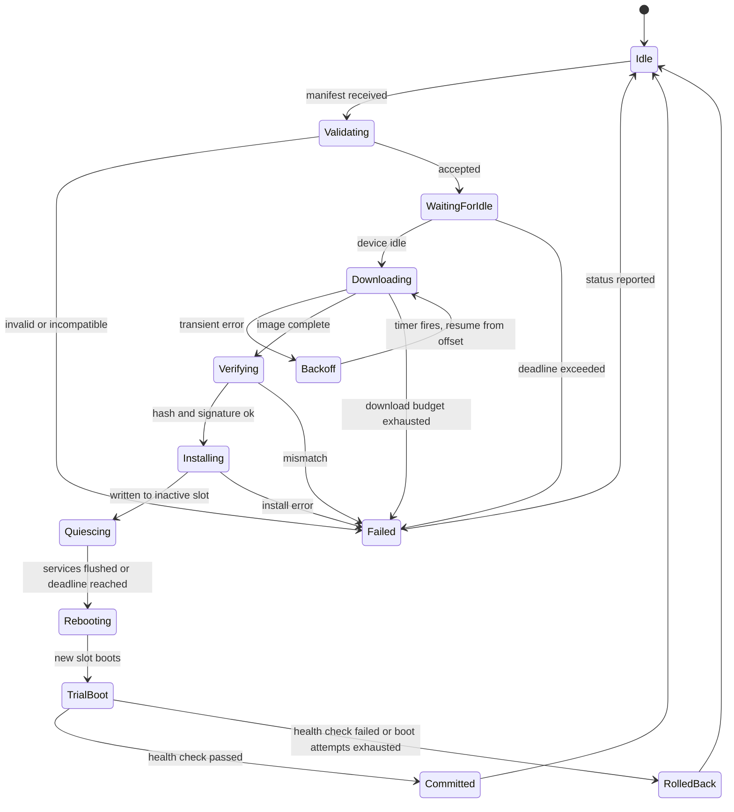

#### Update sequence

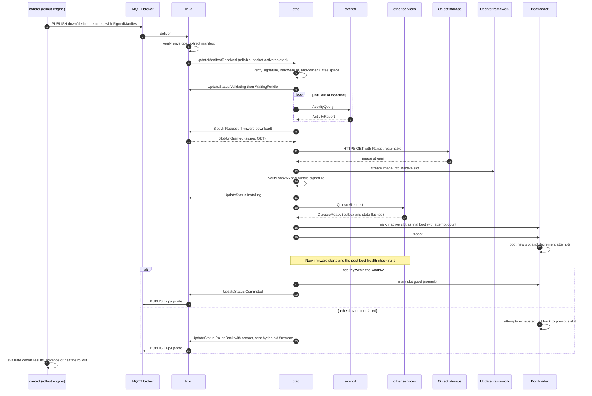

**Details that make it safe**

- **Idle check.** `otad` asks `eventd` (`ActivityQuery`) whether an event or clip is in flight. It waits for an idle moment up to the manifest's install deadline, so a doorbell press is not lost to a reboot.
- **Resumable download.** Firmware images are large, so the download uses HTTP Range requests with persisted offsets, jittered backoff, a bandwidth cap, and streaming SHA-256 verification as data is written to the inactive slot.
- **Health check.** After a trial boot, a oneshot post-boot unit asks `otad` to confirm health: every service reports `Healthy`, the MQTT link reaches `Live`, and a heartbeat is acknowledged, all within a 5-minute window. Only then is the slot marked good.
- **Rollback.** If the window expires, `otad` does not commit and reboots; if the new slot cannot boot at all, the bootloader's boot counter returns the device to the previous slot. Because the pending update is recorded in `/data/camera/update/`, the old firmware recognizes the failed attempt on its next start and reports `RolledBack`.
- **Data compatibility across versions.** Rollback means old firmware must tolerate data written by new firmware. All persisted and wire formats (outbox journal, spool manifests, configuration, state files, FlatBuffers schemas) follow additive-only evolution, and any breaking change is staged across two releases (expand, then contract).
- **Power loss** at any point leaves the active slot untouched.
- **Reporting.** Every state transition is reported through `UpdateStatus` at P0 (progress messages are throttled).

### 4.11 Storage and durability

| Data | Location | Durability rule |
|---|---|---|
| Outbox | `/data/camera/outbox/` | Journal with CRC; P0 fsync per record; quota 16 MiB |
| Spool | `/data/camera/spool/{tmp,ready,failed}/` | Write to `tmp`, fsync, rename into `ready`, fsync directory; quota 256 MB |
| Service state | `/data/camera/state/` | Atomic replace: temp file, fsync, rename, directory fsync |
| Configuration | `/data/camera/config/` | `pending` and `last-known-good` copies |
| Update state | `/data/camera/update/` | Pending update record, download offset, trial status |
| Identity | `/data/camera/identity/` | Certificate chain; private key in a secure element or TPM where available, otherwise a file readable only by `camera-link` |

The pre-roll ring buffer is held in RAM only. Flash writes are minimized to limit wear.

### 4.12 Time

Devices may boot with an incorrect clock. Every message carries `sent` (monotonic nanoseconds plus wall milliseconds), a `boot_id` and a `clock_synced` flag derived from NTP state. The cloud always records its own receive time. For a message from the same boot, the cloud estimates the true occurrence time as `received_at - (sent.mono - occurred.mono)`, which stays valid even when the device wall clock is wrong. Device-side expiry checks on commands are used only when the clock is synced; otherwise the broker's message expiry applies. Blob URL validity is conveyed as a relative TTL, not an absolute time.

### 4.13 Security

| Area | Design |
|---|---|
| Device identity | Per-device X.509 certificate from the fleet CA, CN or SAN is the device UUID; mutual TLS to the broker; key held only by `linkd` |
| Broker authorization | ACLs derived from the certificate: a device may publish only `fleet/{tenant}/{device}/status` and `.../up/#`, and subscribe only to `.../down/#` |
| Least privilege | One Unix user per service, sandboxed units, empty capability sets, socket permissions with peer credential checks |
| Key exposure | `uploadd` and `otad` never hold the device key: blob URLs are pre-signed and issued through `linkd` |
| Input validation | Every buffer from the network or another process is run through the FlatBuffers `Verifier` before any field is read, then semantically validated (ranges, lengths, enum values) |
| Update trust | Offline release signing key, signature verified before the manifest is parsed, anti-rollback counter, secure boot chain, dm-verity on root filesystems |
| Revocation | A revoked device certificate is rejected at the broker; the signing service denies blob URLs to revoked devices |
| Data protection | Clips encrypted at rest, delivered to browsers only through short-lived signed URLs, every query filtered by tenant |

### 4.14 Error handling, memory and build practices

- **Errors.** C++20 with `-fno-exceptions -fno-rtti` in production builds. Fallible functions return a `Result<T, Error>` (an `expected`-style type) and are marked `[[nodiscard]]`. Unit tests are built with a separate configuration.
- **Memory.** No heap allocation per message on hot paths. Pooled, aligned message buffers; fixed-capacity containers for queues; per-handler `std::pmr` monotonic arenas reset after each dispatch; an in-place callable type instead of `std::function` in the reactor; FlatBuffers builders are reused.
- **Value semantics.** Domain messages and events are small immutable value types. Decoded FlatBuffers are converted to plain value types at service boundaries, so business logic does not depend on the wire format. Non-owning views (`std::string_view`, `std::span`) are used for parameters only, never stored across asynchronous boundaries.
- **Flags.** `-Os`, LTO, `-fstack-protector-strong`, `_FORTIFY_SOURCE=2`, PIE, full RELRO, `-Wall -Wextra -Werror`.
- **High-water marks.** Every service reports RSS, queue depth and restarts in `HealthReport`.

## 5. Messaging contracts

### 5.1 One envelope, one schema set

Every message, whether on the local bus or on the wire to the cloud, is a FlatBuffers `Envelope` with a union `Payload`. One schema set in `schemas/` generates C++ for the device and Go for the cloud.

### 5.2 Envelope

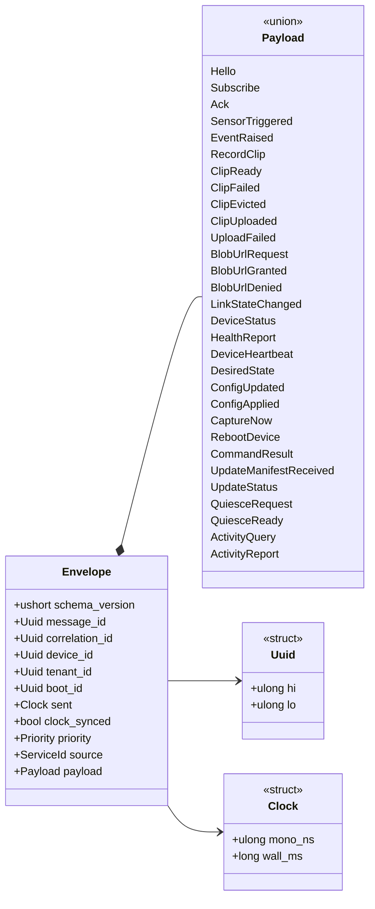

### 5.3 Event and media payloads

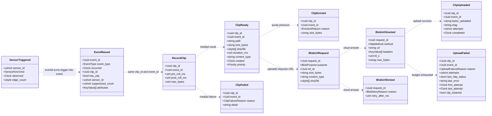

### 5.4 Control, update and health payloads

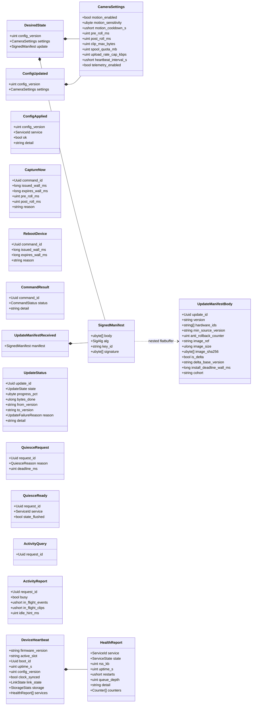

### 5.5 Message catalogue

Delivery: **R** = reliable (acknowledged), **N** = notify. "Cloud leg" lists the MQTT topic suffix under `fleet/{tenant}/{device}/`.

| Payload | Producer to consumer | Class | Cloud leg | Priority |
|---|---|---|---|---|
| `Hello`, `Subscribe` | any peer to any peer | handshake | none | none |
| `Ack` | receiver to sender | reply | none | none |
| `SensorTriggered` | `sensord` to `eventd` | R | none | P0 doorbell, P1 motion |
| `EventRaised` | `eventd` to `linkd` | R | `up/events` | P0 doorbell and manual, P1 motion |
| `RecordClip` | `eventd` to `mediad` | R | none | inherits |
| `ClipReady` | `mediad` to `uploadd` | R | none | inherits |
| `ClipFailed` | `mediad` to `linkd` | R | `up/errors` | P0 |
| `ClipEvicted` | `uploadd` to `linkd` | R | `up/errors` | P1 |
| `BlobUrlRequest` | `uploadd` or `otad` to `linkd`, then cloud | R | `up/rpc` | inherits (P0 for firmware) |
| `BlobUrlGranted`, `BlobUrlDenied` | cloud to `linkd`, then requester | R | `down/rpc` | inherits |
| `ClipUploaded` | `uploadd` to `linkd` (also notify to `eventd`) | R | `up/clips` | inherits |
| `UploadFailed` | `uploadd` to `linkd` | R | `up/errors` | P0 |
| `LinkStateChanged` | `linkd` to all | N, replayed | none | P2 |
| `DeviceStatus` | `linkd` to cloud | retained, last-will | `status` | P0 |
| `HealthReport` | each service to `linkd` | N | aggregated in heartbeat | P2 |
| `DeviceHeartbeat` | `linkd` to cloud | R | `up/telemetry` | P2 |
| `DesiredState` | cloud to `linkd` | retained | `down/desired` | P1 |
| `ConfigUpdated` | `linkd` to all | N, replayed | none | P1 |
| `ConfigApplied` | each service to `linkd` | R | none | P1 |
| `CaptureNow` | cloud to `linkd`, then `eventd` | R | `down/cmd` | P0 |
| `RebootDevice` | cloud to `linkd`, then `otad` | R | `down/cmd` | P0 |
| `CommandResult` | `linkd` to cloud | R | `up/cmdresult` | P0 |
| `UpdateManifestReceived` | `linkd` to `otad` | R | none | P0 |
| `UpdateStatus` | `otad` to `linkd`, then cloud | R | `up/update` | P0 |
| `QuiesceRequest`, `QuiesceReady` | `otad` and every other service | R | none | P0 |
| `ActivityQuery`, `ActivityReport` | `otad` and `eventd` | R | none | P0 |

### 5.6 MQTT topics

Prefix for all device topics: `fleet/{tenant}/{device}/`.

| Topic | Direction | Payloads | QoS | Retained |
|---|---|---|---|---|
| `status` | up | `DeviceStatus` | 1 | yes (last-will publishes offline) |
| `up/events` | up | `EventRaised` | 1 | no |
| `up/clips` | up | `ClipUploaded` | 1 | no |
| `up/errors` | up | `UploadFailed`, `ClipFailed`, `ClipEvicted` | 1 | no |
| `up/telemetry` | up | `DeviceHeartbeat` | 0 | no |
| `up/update` | up | `UpdateStatus` | 1 | no |
| `up/cmdresult` | up | `CommandResult` | 1 | no |
| `up/rpc` | up | `BlobUrlRequest` | 1 | no |
| `down/desired` | down | `DesiredState` | 1 | yes |
| `down/cmd` | down | `CaptureNow`, `RebootDevice` | 1 | no, with message expiry |
| `down/rpc` | down | `BlobUrlGranted`, `BlobUrlDenied` | 1 | no, 5 minute expiry |

Internal topics (services only, not reachable by devices): `internal/stored/{tenant}` (notification after an event or clip status is committed) and `internal/dead-letter` (undecodable or invalid messages).

Wire limits: 64 KiB per message. The `Envelope` payload type is authoritative; topics are a routing convention. The cloud rejects any message whose envelope `device_id` or `tenant_id` does not match the authenticated topic.

### 5.7 Schema definitions

Schemas live in `schemas/` and are compiled with `flatc` for C++ and Go. Types are listed per file; every file uses `namespace camera.v1;`.

**`common.fbs`**

```fbs
namespace camera.v1;

struct Uuid  { hi:ulong; lo:ulong; }
struct Clock { mono_ns:ulong; wall_ms:long; }

enum Priority : ubyte { Unknown = 0, P0Critical = 1, P1Normal = 2, P2Bulk = 3 }

enum ServiceId : ubyte {
  Unknown = 0, Sensord = 1, Eventd = 2, Mediad = 3,
  Uploadd = 4, Linkd = 5, Otad = 6, Cloud = 7
}

enum ServiceState : ubyte { Unknown = 0, Starting = 1, Healthy = 2, Degraded = 3, Stopping = 4 }
enum AckStatus    : ubyte { Unknown = 0, Accepted = 1, Duplicate = 2, Rejected = 3, Busy = 4 }

table KeyValue { key:string; value:string; }
table Counter  { name:string; value:ulong; }
```

**`bus.fbs`**

```fbs
include "common.fbs";
namespace camera.v1;

table Hello     { service:ServiceId; schema_version:ushort; pid:uint; }
table Subscribe { payload_types:[ubyte]; replay_state:bool = true; }  // union discriminant values
table Ack       { acked_message_id:Uuid; status:AckStatus; detail:string; }
```

**`events.fbs`**

```fbs
include "common.fbs";
namespace camera.v1;

enum SensorKind : ubyte { Unknown = 0, Motion = 1, DoorbellPress = 2 }
enum EventType  : ubyte { Unknown = 0, Motion = 1, Doorbell = 2, Manual = 3 }

table SensorTriggered {
  sensor_id:ushort;
  kind:SensorKind;
  observed:Clock;
  edge_count:ubyte = 1;        // debounced edges folded into this trigger
}

table EventRaised {
  event_id:Uuid;
  event_type:EventType;
  occurred:Clock;
  clip_id:Uuid;
  has_clip:bool = true;
  sensor_id:ushort;
  suppressed_count:ushort;     // triggers dropped by cooldown since the previous event of this type
  attributes:[KeyValue];
}
```

**`media.fbs`**

```fbs
include "common.fbs";
namespace camera.v1;

enum ClipFailureReason   : ubyte { Unknown = 0, EncoderError = 1, NoSpace = 2, Timeout = 3, Cancelled = 4 }
enum EvictionReason      : ubyte { Unknown = 0, QuotaPressure = 1, Expired = 2, RetryBudgetExhausted = 3 }
enum UploadFailureReason : ubyte {
  Unknown = 0, RetryBudgetExhausted = 1, UrlDenied = 2, PermanentHttpError = 3,
  ChecksumMismatch = 4, LocalFileMissing = 5, Expired = 6
}

table RecordClip {
  clip_id:Uuid;
  event_id:Uuid;
  pre_roll_ms:uint;
  post_roll_ms:uint;
  max_bytes:uint;
}

table ClipReady {
  clip_id:Uuid;
  event_id:Uuid;
  path:string;                 // ownership of the file transfers with this message
  size_bytes:ulong;
  sha256:[ubyte];              // exactly 32 bytes, checked on receipt
  duration_ms:uint;
  content_type:string;
  created:Clock;
  priority:Priority;           // inherited from the event
}

table ClipFailed  { clip_id:Uuid; event_id:Uuid; reason:ClipFailureReason; detail:string; }
table ClipEvicted { clip_id:Uuid; event_id:Uuid; reason:EvictionReason; size_bytes:ulong; }

table ClipUploaded {
  clip_id:Uuid;
  event_id:Uuid;
  bytes_uploaded:ulong;
  etag:string;
  attempts:ushort;
  completed:Clock;
}

table UploadFailed {
  clip_id:Uuid;
  event_id:Uuid;
  reason:UploadFailureReason;
  attempts:ushort;
  last_http_status:short;
  last_error:string;
  first_attempt:Clock;
  last_attempt:Clock;
  clip_retained:bool;
}
```

**`link.fbs`**

```fbs
include "common.fbs";
namespace camera.v1;

enum BlobPurpose    : ubyte { Unknown = 0, ClipUpload = 1, FirmwareDownload = 2 }
enum HttpMethod     : ubyte { Unknown = 0, Get = 1, Put = 2 }
enum BlobDenyReason : ubyte {
  Unknown = 0, UnknownReference = 1, TooLarge = 2, QuotaExceeded = 3, DeviceRevoked = 4, RateLimited = 5
}
enum LinkState : ubyte { Unknown = 0, Disconnected = 1, Connecting = 2, Draining = 3, Live = 4, Backoff = 5 }

table BlobUrlRequest {
  request_id:Uuid;
  purpose:BlobPurpose;
  ref_id:Uuid;                 // clip_id or update_id
  size_bytes:ulong;            // uploads: exact size; downloads: 0
  content_type:string;
  sha256:[ubyte];              // uploads: bound into the signed URL
}

table BlobUrlGranted {
  request_id:Uuid;
  method:HttpMethod;
  url:string;
  headers:[KeyValue];          // must be sent verbatim (content type, checksum)
  ttl_s:uint;                  // relative validity, measured from receipt
  max_bytes:ulong;
}

table BlobUrlDenied { request_id:Uuid; reason:BlobDenyReason; retry_after_ms:uint; }

table LinkStateChanged { state:LinkState; since:Clock; outbox_depth:uint; reason:string; }
table DeviceStatus     { online:bool; firmware_version:string; boot_id:Uuid; }

table HealthReport {
  service:ServiceId;
  state:ServiceState;
  rss_kb:uint;
  uptime_s:uint;
  restarts:ushort;
  queue_depth:uint;
  detail:string;
  counters:[Counter];
}

table StorageStats {
  spool_used_mb:uint;
  spool_quota_mb:uint;
  outbox_used_kb:uint;
  data_free_mb:uint;
}

table DeviceHeartbeat {
  firmware_version:string;
  active_slot:string;
  boot_id:Uuid;
  uptime_s:uint;
  config_version:uint;
  clock_synced:bool;
  link_state:LinkState;
  storage:StorageStats;
  services:[HealthReport];
}
```

**`ota.fbs`**

```fbs
include "common.fbs";
namespace camera.v1;

enum SigAlg : ubyte { Unknown = 0, Ed25519 = 1 }

enum UpdateState : ubyte {
  Unknown = 0, Idle = 1, Validating = 2, WaitingForIdle = 3, Downloading = 4, Verifying = 5,
  Installing = 6, Quiescing = 7, Rebooting = 8, TrialBoot = 9, Committed = 10,
  RolledBack = 11, Failed = 12
}

enum UpdateFailureReason : ubyte {
  Unknown = 0, BadSignature = 1, Incompatible = 2, DowngradeRefused = 3, NoSpace = 4,
  DownloadFailed = 5, HashMismatch = 6, InstallFailed = 7, HealthCheckFailed = 8,
  BootFailed = 9, DeadlineExceeded = 10
}

enum QuiesceReason : ubyte { Unknown = 0, Update = 1, Reboot = 2 }

// Serialized once by the release signer. The signature covers exactly these bytes.
table UpdateManifestBody {
  update_id:Uuid;
  version:string;
  hardware_ids:[string];
  min_source_version:string;
  anti_rollback_counter:uint;
  image_ref:string;                  // opaque object key, resolved via BlobUrlRequest
  image_size:ulong;
  image_sha256:[ubyte];
  is_delta:bool;
  delta_base_version:string;
  install_deadline_wall_ms:long;     // 0 = no deadline
  cohort:string;
}

table SignedManifest {
  body:[ubyte] (nested_flatbuffer: "UpdateManifestBody");
  alg:SigAlg;
  key_id:string;
  signature:[ubyte];
}

table UpdateManifestReceived { manifest:SignedManifest; }

table UpdateStatus {
  update_id:Uuid;
  state:UpdateState;
  progress_pct:ubyte;
  bytes_done:ulong;
  from_version:string;
  to_version:string;
  reason:UpdateFailureReason;
  detail:string;
}

table QuiesceRequest  { request_id:Uuid; reason:QuiesceReason; deadline_ms:uint; }
table QuiesceReady    { request_id:Uuid; service:ServiceId; state_flushed:bool; }
table ActivityQuery   { request_id:Uuid; }
table ActivityReport  {
  request_id:Uuid;
  busy:bool;
  in_flight_events:ushort;
  in_flight_clips:ushort;
  idle_hint_ms:uint;
}
```

**`control.fbs`**

```fbs
include "common.fbs";
include "ota.fbs";
namespace camera.v1;

enum CommandStatus : ubyte {
  Unknown = 0, Accepted = 1, Completed = 2, Rejected = 3, Expired = 4, Duplicate = 5, Failed = 6
}

table CameraSettings {
  motion_enabled:bool = true;
  motion_sensitivity:ubyte = 50;
  motion_cooldown_s:ushort = 30;
  pre_roll_ms:uint = 3000;
  post_roll_ms:uint = 7000;
  clip_max_bytes:uint = 10485760;
  spool_quota_mb:uint = 256;
  upload_rate_cap_kbps:uint = 0;     // 0 = unlimited
  heartbeat_interval_s:ushort = 300;
  telemetry_enabled:bool = true;
}

table DesiredState {                 // cloud to device, retained
  config_version:uint;
  settings:CameraSettings;
  update:SignedManifest;             // absent when no update is assigned
}

table ConfigUpdated { config_version:uint; settings:CameraSettings; }                     // local
table ConfigApplied { config_version:uint; service:ServiceId; ok:bool; detail:string; }   // local

table CaptureNow {
  command_id:Uuid;
  issued_wall_ms:long;
  expires_wall_ms:long;
  pre_roll_ms:uint;
  post_roll_ms:uint;
  reason:string;
}

table RebootDevice { command_id:Uuid; issued_wall_ms:long; expires_wall_ms:long; reason:string; }
table CommandResult { command_id:Uuid; status:CommandStatus; detail:string; }
```

**`envelope.fbs`**

```fbs
include "common.fbs";
include "bus.fbs";
include "events.fbs";
include "media.fbs";
include "link.fbs";
include "control.fbs";
include "ota.fbs";
namespace camera.v1;

// New members are appended at the end only. Never reorder or remove members.
union Payload {
  Hello, Subscribe, Ack,
  SensorTriggered, EventRaised,
  RecordClip, ClipReady, ClipFailed, ClipEvicted, ClipUploaded, UploadFailed,
  BlobUrlRequest, BlobUrlGranted, BlobUrlDenied,
  LinkStateChanged, DeviceStatus, HealthReport, DeviceHeartbeat,
  DesiredState, ConfigUpdated, ConfigApplied, CaptureNow, RebootDevice, CommandResult,
  UpdateManifestReceived, UpdateStatus,
  QuiesceRequest, QuiesceReady, ActivityQuery, ActivityReport
}

table Envelope {
  schema_version:ushort = 1;
  message_id:Uuid;
  correlation_id:Uuid;               // event id for event-driven chains
  device_id:Uuid;
  tenant_id:Uuid;
  boot_id:Uuid;
  sent:Clock;
  clock_synced:bool;
  priority:Priority;
  source:ServiceId;
  payload:Payload;
}

root_type Envelope;
file_identifier "CAM1";
```

### 5.8 Schema rules and validation

| Rule | Detail |
|---|---|
| Evolution | Add fields only at the end of a table; add union members only at the end; never reorder, remove or change types; retire fields with `deprecated`. CI runs `flatc --conform` against the last released schema set and fails on incompatible changes. |
| Enums | Every enum has `Unknown = 0`; receivers treat unknown or out-of-range values as `Unknown` and never crash. |
| Verification | The C++ `Verifier` runs on every inbound buffer from the network or any peer process. The file identifier (`CAM1`) is checked. The Go runtime has no structural verifier equivalent to the C++ one, so `ingest` wraps decoding in a size-limited, panic-recovering decoder, validates every field semantically, and is fuzz-tested; failures go to the dead-letter topic. |
| Semantic validation | Lengths (such as `sha256` is exactly 32 bytes), ranges, identity (`device_id` and `tenant_id` match the authenticated session), non-empty required fields, bounded vector lengths. |
| Absent versus default | FlatBuffers does not store default values, so a missing scalar equals its default. Fields where this matters carry explicit "unknown" enum values. |
| Signed content | `SignedManifest.body` is a nested FlatBuffer. The signature covers its exact bytes. The device verifies the signature first, then runs the `Verifier`, then parses. |
| Alignment | Receive buffers are aligned (8 bytes) so zero-copy reads are valid. |
| Debugging | A tool in `tools/` dumps any buffer as JSON using the schemas (`flatc --json` and a small CLI). Logs record the payload type and IDs, not raw bytes. |
| Wire format | Messages on the bus and the wire are identical `Envelope` buffers. Domain logic converts them to plain value types at service boundaries. |

## 6. Cloud architecture

### 6.1 Broker

EMQX provides mutual-TLS authentication, certificate-derived ACLs, MQTT 5 features (shared subscriptions, message expiry, response topics, session expiry), retained messages and a persistent session store. The ingest and control services are the only non-device clients; their credentials and ACLs are scoped to their own topics. The broker is horizontally scalable; a single node serves the exercise.

### 6.2 `ingest` service

- Subscribes to `$share/ingest/fleet/+/+/up/#` and `fleet/+/+/status`. Shared subscriptions spread load across replicas.
- Decodes with the hardened decoder, validates identity against the topic, and writes to MongoDB. All writes are **idempotent upserts**, keyed by the event or message ID, so redelivery from QoS 1 is harmless.
- Handles out-of-order arrival: a `ClipUploaded` that arrives before its `EventRaised` creates the event document with `$setOnInsert` defaults and a clip sub-document, and the later `EventRaised` fills in the rest.
- Answers `BlobUrlRequest` on `up/rpc` by authorizing the device (not revoked, tenant quota, size limit, known clip or release) and replying on `down/rpc` with a pre-signed URL. For clips the object key is derived from IDs (`clips/{tenant}/{device}/{yyyy}/{mm}/{dd}/{clip_id}.mp4`) and the URL binds the size and checksum header; the device never chooses the key.
- After each committed change publishes a notification on `internal/stored/{tenant}`.
- Invalid or undecodable messages go to `internal/dead-letter` and a capped `dead_letters` collection; a poison message never blocks the consumer.
- Stores heartbeats, `UpdateStatus` and `CommandResult` into the `devices` collection and error reports into `device_errors`.
- Stateless and horizontally scalable.

### 6.3 Data model

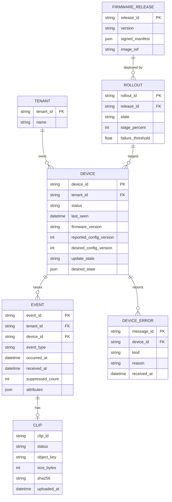

The clip is an embedded sub-document of the event, with `status` one of `none`, `pending`, `available`, `failed`, `evicted`. Documents carry `tenant_id` and `schema_version`.

**Access patterns and indexes**

| Query | Index |
|---|---|
| Events for a device, newest first | `{tenant_id, device_id, occurred_at: -1}` |
| Fleet-wide events by time | `{tenant_id, occurred_at: -1}` |
| Events by type | `{tenant_id, event_type, occurred_at: -1}` |
| SSE resume (events since a cursor) | `{tenant_id, received_at: 1, _id: 1}` |
| Retention | TTL index on `received_at` (default 90 days) |

The document store was chosen for flexible per-event attributes and schema evolution; the access patterns above are the design driver. Pagination is cursor-based, never offset-based. Object storage lifecycle rules expire clips (default 30 days); the API handles missing clips gracefully.

### 6.4 `api` service

Read-only REST API, authenticated by bearer token (OIDC JWT with a tenant claim in production, static tokens in the simulator). Every query is filtered by tenant on the server.

| Endpoint | Purpose |
|---|---|
| `GET /v1/events` | Search with `device_id`, `type`, `from`, `to`, `has_clip`, `limit`, `cursor` |
| `GET /v1/events/{id}` | One event with clip status |
| `GET /v1/events/{id}/clip` | Returns a short-lived (60 s) signed GET URL |
| `GET /v1/devices` and `/v1/devices/{id}` | Fleet and device state: online, firmware, config version, update state, recent errors |
| `GET /v1/devices/{id}/errors` | Recent device error reports |
| `GET /healthz`, `/readyz`, `/metrics` | Operations |

### 6.5 `web` service and live updates

The dashboard is server-rendered Go templates with a small amount of vanilla JavaScript. Live updates use Server-Sent Events.

- `GET /stream/events` subscribes the browser to events for its tenant (optionally filtered by device or type).
- The `web` service subscribes to `internal/stored/#` on the broker (a normal, non-shared subscription, so every replica sees every notification) and fans out to connected browsers. Because notifications are sent only after the database commit, the UI never shows data that is not persisted.
- Each SSE message carries an `id` cursor of `received_at` plus `event_id`. On reconnect the browser sends `Last-Event-ID` and the service replays missed items from MongoDB before switching to live data; if the gap is too large it asks the page to reload the first page of history.
- A keep-alive comment is sent every 15 s; each client has a bounded buffer and a slow client is disconnected and resumes from its cursor.
- History pages call the `api` service. Clips are played from short-lived signed URLs; an event whose clip is `pending` shows "clip processing", and one that is `failed` shows the failure state.

### 6.6 `control` service and rollouts

`control` is the single writer of device desired state, so configuration and firmware assignment never overwrite each other.

| Endpoint | Purpose |
|---|---|
| `POST /v1/devices/{id}/commands/capture` | Publish `CaptureNow` with message expiry |
| `POST /v1/devices/{id}/commands/reboot` | Publish `RebootDevice` |
| `PUT /v1/devices/{id}/config` and `PUT /v1/fleets/{id}/config` | Bump `config_version`, store settings, republish `DesiredState` |
| `POST /v1/releases` | Register a pre-signed release manifest |
| `POST /v1/rollouts`, `POST /v1/rollouts/{id}/pause`, `/resume`, `/abort` | Manage staged rollouts |

**Rollout engine.** A rollout targets a cohort in stages (for example 1%, 10%, 50%, 100%) with a soak period between stages. It composes each device's `DesiredState` (settings plus manifest) from the database and publishes it as a retained message. It watches reported `UpdateStatus` results (stored by `ingest`) and halts automatically when the failure or rollback rate exceeds the rollout's threshold.

**Signing.** The `control` service never holds the firmware signing key. Release manifests are signed offline in the release pipeline and registered as-is. Devices verify them independently.

### 6.7 Object storage

An S3-compatible store with server-side encryption, private buckets, tenant-prefixed keys, and lifecycle rules. Clips are written only through pre-signed `PUT` URLs; reads only through short-lived pre-signed `GET` URLs. Firmware images are stored under a separate prefix and downloaded through pre-signed `GET` URLs requested over the same blob RPC.

## 7. Simulation

A simulated device is the real service binaries with simulation adapters, started by a small device supervisor that stands in for systemd. The simulator runs many devices on one machine.

- **Isolation.** Each device has its own directory tree (`outbox/`, `spool/`, `state/`, `config/`, `update/`, sockets, certificates) and its own certificate issued by a local CA.
- **Adapters.** Production binaries link hardware adapters; simulator binaries link `SimEventSource`, `SyntheticClipSource`, `SimClock` and `SimSlotBackend`, selected at build time, so no simulation code ships in the field image. Core logic is identical.
- **Scenarios.** Declarative files describe per-device event rates and patterns (motion bursts, doorbell presses, jitter) with a seeded random generator for reproducibility. The injectable clock lets scenario timelines and backoff timers run faster than real time.
- **Simulated OTA.** Slots are directories (`slotA/`, `slotB/`) plus a boot-control state file (active slot, trial flag, attempts). "Reboot" restarts the device's process group from the selected slot. Firmware images are tarballs with an Ed25519-signed manifest from a test key. Test releases include deliberately bad versions (crashes on start, fails the health check) to demonstrate rollback.
- **Fault injection.** A control tool and a network proxy between devices and the broker or object store can drop the network, add latency, throttle bandwidth, return 5xx or 403, truncate or corrupt a clip, kill a service, fill the spool, or skew a device clock.
- **Demonstration scenarios.** (1) Steady state with N devices. (2) Broker outage: devices buffer, then drain with no lost or duplicated events. (3) Object store failure: retries, then `UploadFailed` appears in the dashboard. (4) Staged rollout of a good release. (5) Rollout of a bad release: automatic rollback and the rollout halts.
- **Run.** `docker compose up` starts the broker, MinIO, MongoDB, the four Go services and a configurable number of simulated devices.

## 8. Observability

| Area | Design |
|---|---|
| Device logs | Structured JSON lines to the journal with `service`, `level`, `device_id`, `correlation_id`; rate limited; no secrets or payload bytes |
| Device metrics | Counters and gauges inside `HealthReport` and `DeviceHeartbeat` (queue depth, outbox size, RSS, restarts, upload attempts, spool usage) |
| Cloud metrics | Prometheus `/metrics` on every service |
| Health endpoints | `/healthz` (liveness) and `/readyz` (readiness) on every Go service |
| Tracing | Event ID as the correlation key across processes and into cloud logs; OpenTelemetry in the Go services |
| Key indicators | Event-to-visible latency (p95), clip availability latency, outbox depth, consumer lag, upload success rate, devices online, update success and rollback rate, dead-letter rate |
| Alerts | Consumer lag, rising dead letters, upload failure rate, devices going offline in clusters, rollout halted |

## 9. Failure modes

| Failure | Behaviour |
|---|---|
| Network down | Events land in the durable outbox; uploads pause; everything drains with jittered backoff on reconnect, in priority order |
| Duplicate delivery | Unique IDs and idempotent upserts make duplicates harmless |
| Upload interrupted or fails | Retried with backoff; classified errors; after the budget, `UploadFailed` is reported and the dashboard shows the failed clip |
| Expired upload URL | A new URL is requested automatically |
| Device reboot or power loss mid-flight | Outbox and spool are durable; processes recover from journals and restart uploads |
| `sensord` crash | Restarted within seconds; hardware fds survive via the systemd fd store |
| `mediad` crash or encoder error | The event is still reported; the clip is reported failed with a reason |
| `uploadd` crash | Spool and retry state are durable; uploads resume |
| `linkd` crash | Outbox is durable; peers retry until it returns |
| `eventd` crash | Restarts and rebuilds soft state (cooldowns); the window between sensor trigger and `linkd` acknowledgement is milliseconds and each hop retries |
| Spool or outbox full | Priority-aware eviction (P2 first, then P1; P0 never), with eviction events reported |
| Poison or malformed message | Verifier and semantic checks reject it; it is dead-lettered; processing continues |
| Database down | `ingest` stops acknowledging; the broker retains messages; alerts fire |
| Broker outage or mass reconnect | Devices back off with jitter; broker and ingest rate limits protect the backend |
| Wrong device clock | Boot-relative timestamps and receive time let the cloud correct occurrence time |
| Stolen or compromised device | Certificate revocation at the broker; URL requests denied; topic ACLs confine it to its own topics |
| Command replay or stale command | Message expiry, per-command ID replay window, device targeting checks |
| Bad configuration | Validated, held pending until all services apply it, reverted to last-known-good on failure |
| Power loss during update | Active slot untouched; download resumes; install restarts |
| Corrupt or tampered firmware | Signature or hash check fails; update discarded and reported |
| New firmware boots but is broken | Health check fails; no commit; automatic rollback |
| New firmware does not boot | Bootloader boot counter reverts to the previous slot |
| Bad release reaches the fleet | Staged rollout halts when the failure rate crosses the threshold |

## 10. Testing strategy

| Level | Approach |
|---|---|
| Unit | GoogleTest for C++ and `testing` for Go; state machines (`uploadd`, `linkd`, `otad`, `eventd` policy) tested with an injected fake clock so backoff and timeouts run instantly |
| Property and fuzz | libFuzzer on C++ `Verifier` entry points and message handlers; Go native fuzzing on the ingest decoder; schema evolution checked with `flatc --conform` in CI |
| Component | Each service run against fake peers over real sockets; outbox journal crash-recovery tests (kill at every write step); spool atomicity tests |
| Integration | Compose environment with simulated devices; automated fault-injection scenarios listed in the simulation section, with assertions on no loss, no duplicates, and bounded latency |
| Sanitizers | ASan, UBSan and TSan builds of all C++ tests in CI; `clang-tidy` and `cppcheck` |
| Cross build | CI builds the services with the Yocto SDK toolchain and runs size and memory budget checks (`MemoryMax` and RSS thresholds) |
| Soak | Long-running simulation checking for leaks, descriptor leaks and unbounded growth, with high-water marks tracked |

## 11. Repository, build and delivery

```
.
├── schemas/                 FlatBuffers schemas (single source of truth)
├── device/
│   └── camera/
│       ├── libs/            reactor, bus, common, value types, generated schema code, hal ports
│       ├── services/        sensord, eventd, mediad, uploadd, linkd, otad
│       ├── adapters/        hw/ (gpiod, camera, system clock, rauc) and sim/ (event source, clip source, clock, slot backend)
│       ├── packaging/       systemd units and sockets, Yocto recipes (meta-camera), wic layout
│       └── tests/
├── cloud/
│   ├── ingest/
│   ├── api/
│   ├── control/
│   ├── web/
│   └── internal/            shared Go packages, generated schema code, hardened decoder
├── sim/                     device supervisor, scenarios, fault-injection tool, local CA
├── deploy/                  docker compose, broker ACL config, MinIO and MongoDB setup
├── tools/                   schema JSON dump tool, release signing tool, manifest builder
└── docs/                    this document, runbooks, decision records
```

- **Build.** CMake with presets for host (sanitizers) and cross (Yocto SDK) builds; Go modules for the cloud; `flatc` invoked from both builds from the same `schemas/`.
- **Yocto.** A `meta-camera` layer provides the recipes for the six services, systemd units and socket units, the image definition, and the A/B partition layout (wic), together with `meta-rauc`.
- **CI.** Build matrix (host with sanitizers, cross), static analysis, unit and fuzz tests, schema compatibility check, the compose-based integration suite, container image builds.
- **One-command start.** `docker compose up` with a scenario file.

## 12. Delivery scope and non-goals

**Implemented**

- All six device services, the shared reactor and bus, the durable outbox and spool, retry and backoff, error events, and the simulated hardware and media adapters
- MQTT transport with per-device mutual TLS and ACLs, FlatBuffers across the bus and the wire
- The four Go services, the data model, live dashboard with SSE and resume, history search
- Server-pushed commands and desired-state configuration with last-known-good revert
- OTA against the simulated slot backend: signed manifests, idle check, resumable download, quiesce, trial boot, health-checked commit, rollback, and staged rollouts with automatic halt
- Fault-injection scenarios and the one-command environment

**Designed, not implemented in this repository**

- RAUC and U-Boot integration on real hardware (the `IUpdateBackend` port and the packaging layout are specified)
- Delta updates
- Automated certificate renewal and fleet CA operations
- Multi-region deployment and broker clustering

**Non-goals**

Real camera drivers and ISP tuning, video transcoding, end-user accounts and mobile apps, push notifications, on-device analytics, billing.

## 13. Decision log

| Decision | Rationale | Alternatives considered |
|---|---|---|
| Six cooperating processes | Fault isolation, privilege separation, independent lifecycles and memory ceilings | Single process with threads; fewer, larger services |
| Message passing only, no shared state | Removes locking bugs, simplifies testing, enforces ownership | Shared memory segments |
| Unix `SOCK_SEQPACKET` sockets for the local bus | Message boundaries, reliability, peer credentials, socket activation, no extra process | Local MQTT broker; D-Bus; local gRPC |
| Reliable (acknowledged) and notify classes | Durability where required, cheap fan-out elsewhere | Everything fire-and-forget; everything acknowledged |
| Clips by file ownership transfer, not through the bus | Avoids copying megabytes and bus congestion | Streaming clips as messages |
| MQTT 5 over mTLS for the device to cloud path | Small overhead, persistent sessions, QoS 1, last-will, per-device ACLs, response topics | AMQP (heavier clients, server-to-server focus); gRPC (large client, no built-in queue semantics) |
| HTTPS with pre-signed URLs for bulk data | Keeps large payloads off the broker; the device never holds storage credentials | Uploading through the API; MQTT chunks |
| Single streamed `PUT` per clip | Clips are small (at most 10 MB); simpler and more robust than multipart (5 MiB minimum part size) | Multipart or resumable uploads (documented extension for larger objects) |
| FlatBuffers everywhere | Zero-copy reads, tiny runtime, immutable value-like buffers, one schema for C++ and Go | Protocol Buffers; JSON |
| Envelope with a single payload union | One verifier, one dispatch point, additive evolution | Per-topic message types without a common wrapper |
| `linkd` as sole connection owner and key holder | One session, one credential owner, smallest attack surface | Separate processes per direction |
| `otad` as a separate, on-demand service | Independent of application health, privileged boundary, no steady-state memory cost | Updates handled inside `linkd` or an application service |
| Whole-image A/B updates with boot counting | Atomic, power-loss safe, automatic rollback | In-place package updates; container-only updates |
| Manifest signature end to end | Transport compromise cannot push firmware | Trusting TLS and the control plane alone |
| Desired state (retained) plus expiring commands | Offline devices converge on reconnect; urgent actions do not run stale | Imperative push only |
| Single writer (`control`) for desired state | Prevents configuration and firmware assignments overwriting each other | Multiple publishers |
| Event published immediately, clip follows | Dashboard latency in seconds while uploads take longer | Publishing the event only after the clip is uploaded |
| Idempotent upserts keyed by client-generated IDs | Safe under at-least-once delivery and out-of-order arrival | Exactly-once delivery |
| MongoDB for event metadata | Flexible attributes, simple indexes for the defined access patterns, TTL retention | Relational database (also viable at small scale) |
| SSE with resume cursor | Simple, one-directional, proxy friendly, resumable | WebSockets; polling |
| `-fno-exceptions -fno-rtti` in production | Smaller, more predictable footprint | Exceptions enabled |
| Dynamic linking of shared libraries | Pages shared across the six processes | Static linking |
